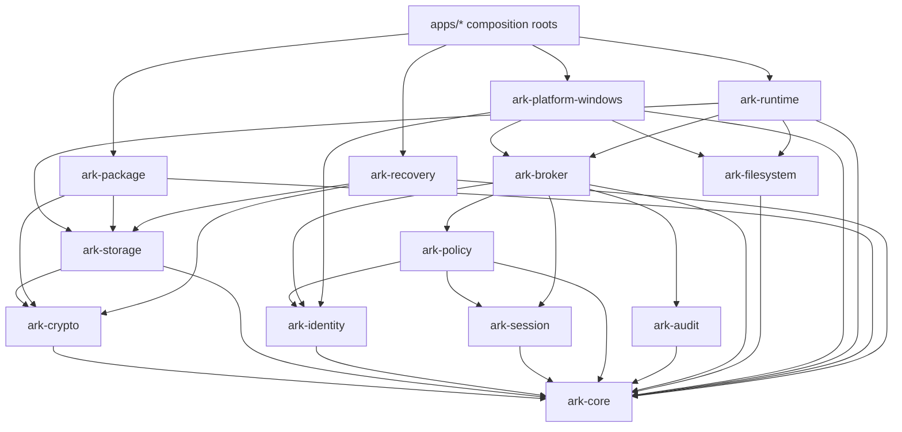

# ARK Crate Boundaries and Dependency Architecture

**Status:** Proposed implementation map. The only materialized crate in this milestone is ark-core. All other crates below are planned boundaries, not empty placeholders or approved public APIs.

## 1. Purpose

This document translates the accepted modular-Rust direction into an implementable dependency model for a small team. It separates three things that are often conflated:

1. **Ownership:** which subsystem is responsible for a capability.
2. **Compilation dependency:** which crate may import another crate.
3. **Runtime authority:** which component is allowed to make or enforce a security decision.

A compile-time dependency never grants runtime authority. A UI crate importing a command interface, for example, does not become an authorization authority.

## 2. Non-negotiable dependency principles

- ark-core is the bottom of the graph. It may use the Rust standard library but no other ARK crate.
- Dependencies point toward stable contracts and domain vocabulary, never from a low-level contract toward a concrete implementation.
- No cyclic crate dependencies.
- Do not create a crate merely because it appears in the long-term architecture. Create it when it owns a real, testable responsibility.
- Keep OS APIs, GUI frameworks, filesystem-driver libraries, and concrete cryptographic libraries out of ark-core.
- Keep policy evaluation out of UI, runtime presentation code, and platform adapters.
- Platform adapters provide evidence and enforcement mechanisms; they do not invent product policy.
- Runtime orchestration must obtain authorization through the broker boundary. It must not infer permission from mode, path, process name, UI state, or a cached display label.
- Do not define generic crypto-provider traits or key abstractions in ark-core. Cryptographic API design belongs to the cryptography owner.
- Keep persistent-format serialization out of general domain types until the owning format defines canonical encoding, limits, and version behavior.

## 3. Proposed crate responsibilities

| Crate | Primary responsibility | Must not own |
|---|---|---|
| ark-core | Typed domain identifiers, shared error codes, runtime-mode vocabulary, independent version-domain types | OS access, key material, crypto algorithms, authorization decisions, persistence formats |
| ark-crypto | Reviewed cryptographic constructions, key lifecycle primitives, authenticated chunk operations, secret handling | Filesystem mediation, user interface, policy decisions |
| ark-storage | Encrypted storage format, manifest/index, journal, transactions, snapshots, locking, crash recovery | User authentication, UI, process identity |
| ark-identity | Normalized identity evidence and verification contracts | Permission grants or policy decisions |
| ark-session | Session binding, lifecycle, expiry, and revocation state | Process identity proof or policy evaluation |
| ark-policy | Deterministic default-deny policy evaluation, scope matching, deny precedence, operation classification | OS process inspection, UI authority |
| ark-audit | Privacy-conscious security event model and audit sink contract | Secrets, plaintext content, authorization decisions |
| ark-broker | Trusted orchestration of identity, session, policy, and authorized operation requests | GUI authority, cryptographic key derivation |
| ark-filesystem | Common filesystem operation and handle-lifecycle contracts | Concrete OS driver implementation, product authorization policy |
| ark-runtime | Development/Execution Mode lifecycle and coordination | Independent authorization decisions, crypto implementation |
| ark-platform-windows | Windows process evidence, IPC, filesystem mediation, and OS-specific enforcement | Product policy or workspace key hierarchy |
| ark-platform-linux | Linux process evidence, IPC, filesystem mediation, and OS-specific enforcement | Product policy or workspace key hierarchy |
| ark-platform-macos | macOS process evidence, IPC, filesystem mediation, and OS-specific enforcement | Product policy or workspace key hierarchy |
| ark-package | Portable encrypted package assembly, verification, and staged import | Workspace authorization policy, independent crypto design |
| ark-recovery | Recovery artifact and recovery lifecycle orchestration | Raw-key persistence or an implicit escrow mechanism |
| apps/ark-cli, apps/ark-desktop, apps/ark-rescue | Composition roots and user-facing workflows | Security authority or direct bypasses around the broker |

These descriptions establish boundaries, not permission to implement every crate immediately. The cryptography, storage format, identity, policy, and recovery owners must review their own public contracts before those crates are materialized.

## 4. Candidate compilation graph

The arrows below point from a dependent crate to a crate it may import. This is a proposed compile-time graph, not a data-flow diagram and not a final public API contract.

Linux and macOS platform crates follow the same contract direction as the Windows adapter, with their own OS-specific dependencies. The composition root wires concrete adapters into runtime interfaces; ark-runtime must not import a concrete operating-system implementation merely to make the first platform work.

## 5. Critical boundary explanations

### 5.1 Core is vocabulary, not a service locator

ark-core currently provides opaque typed identifiers, a RuntimeMode enum, independent version newtypes, and a sanitized error taxonomy. It intentionally does not provide:
- identifier generation or entropy;
- identity evidence or authentication;
- grants, permission rules, or policy evaluation;
- session creation or revocation logic;
- key types, key derivation, AEAD wrappers, or nonce allocation;
- storage serialization, filesystem access, or process spawning.

This keeps the lowest layer portable and makes it difficult for higher-level code to smuggle authority into a primitive type.

### 5.2 Identity is evidence; policy is a decision

ark-identity produces verified, freshness-bound evidence through platform-specific mechanisms. ark-session represents bounded session state. ark-policy consumes typed inputs and returns a deterministic policy result. None of these roles should be collapsed into a process-name allowlist, a UI toggle, or a path check.

### 5.3 Broker is the authorization boundary

The broker coordinates current identity evidence, session validity, policy evaluation, and audit events for protected operations. A platform adapter may submit a request to the broker, but it must not implement its own permissive fallback when the broker is unavailable. Unknown, stale, incomplete, or unverifiable inputs fail closed.

The broker's exact request and decision types are not defined in this milestone. They require review alongside identity, session, and policy owners.

### 5.4 Runtime coordinates; it does not authorize

ark-runtime owns the lifecycle and orchestration of Development Mode and Execution Mode. The selected mode describes the workflow, not permission. Every protected request remains subject to current broker authorization and the relevant storage/filesystem contract.

### 5.5 Platform adapters enforce documented OS semantics

A platform adapter implements only the OS operations it can actually mediate and test. It must expose capability gaps explicitly. A path translation, file watcher, or userspace facade that does not intercept the claimed operation is not a complete mediation backend.

### 5.6 Storage and crypto remain separate

ark-storage owns transactional persistence and format interpretation. ark-crypto owns reviewed cryptographic operations. The storage layer may consume crypto interfaces, but it must not invent algorithms, key hierarchy, nonce allocation, or a custom streaming protocol.

## 6. Implementation sequence and gates

| Stage | Deliverable | Required gate before depending on it |
|---|---|---|
| 0 | Cargo workspace and ark-core domain baseline | Build, formatting, Clippy, core unit tests |
| 1 | Cryptographic API and library selection | Owner review, test vectors, nonce/key lifecycle analysis, independent crypto review |
| 2 | Encrypted storage prototype | Format ADR, authenticated metadata, transaction ordering, fault injection, recovery tests |
| 3 | Identity/session/policy/broker contracts | Threat-model traceability, default-deny negative tests, independent security review |
| 4 | Windows filesystem and process-identity prototype | Actual OS mediation, handle/race tests, capability matrix, compatibility evidence |
| 5 | Development and Execution runtime integration | Broker-mediated access, lifecycle tests, revocation/handle semantics, PHP/Apache MVP |
| 6 | Portable package and recovery integration | Format/version review, hostile-input tests, staged import, recovery tests |
| 7 | Desktop and delivery integration | UI remains non-authoritative, signed updates, failure-safe install/rollback |

Stages may overlap only when the interface and security ownership are explicit. A team member must not silently replace another member's accepted cryptographic, threat-model, or policy decision.

## 7. Dependency enforcement rules

Every new crate or dependency must answer these questions in its PR:

1. What single responsibility does the crate own?
2. Which lower-level contracts does it consume?
3. Why can the responsibility not live in an existing crate?
4. Does the proposed edge introduce a cycle or move policy/authority downward?
5. Which trust boundary does it cross?
6. Which invariants and negative tests prove the boundary?
7. Which team member owns the subsystem contract and who independently reviews it?

The initial workspace has no external Rust dependencies. Do not add a serialization, async, logging, UUID, GUI, filesystem, or crypto dependency until a concrete use case and owner review justify it.

## 8. Current implementation status

Implemented in this foundation branch:
- Cargo workspace metadata and stable toolchain configuration.
- ark-core typed identifiers, runtime mode vocabulary, version-domain types, and sanitized errors.
- Base CI for formatting, build, Clippy, and tests on Windows, Linux, and macOS.
- Pull-request commit-header validation.

Not implemented by this branch:
- cryptographic operations or key management;
- storage format, WAL, transaction engine, or recovery;
- identity verification, session service, policy engine, or broker;
- runtime process control, filesystem mediation, or platform backends;
- package/recovery engines, CLI, desktop UI, or installers.

A passing foundation CI run is not a security audit and does not establish any of the unimplemented properties above.
