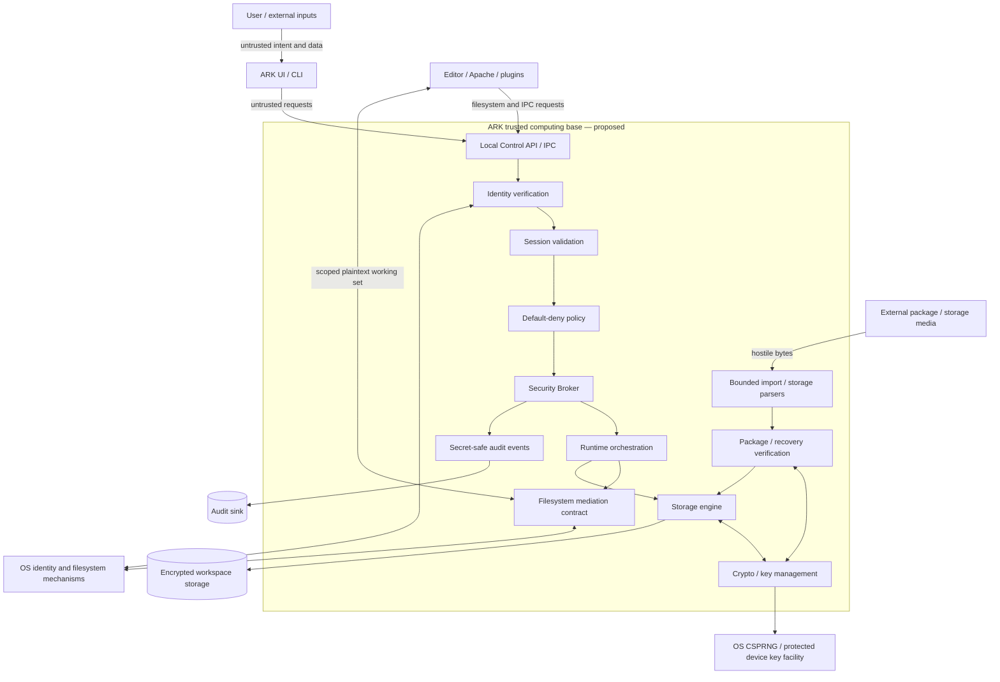

# ARK System Trust Boundaries and Security-Critical Data Flows

**Status:** Proposed system-level security model; owner review required.  
**Issue:** [#18 — E-04]  
**Baseline:** ADR-0005 / PR #2 foundation branch, current architecture and security documents.  
**Last updated:** 2026-11-19.

> This document is a design and review artifact. It does not claim that the broker, crypto engine, storage engine, identity/session/policy services, filesystem mediation, recovery engine, audit sink, or runtime have been implemented. Only the Core foundation described by PR #2 is implemented on its branch; ADR-0005 itself remains Proposed and PR #2 is not yet merged.

## 1. Purpose and status vocabulary

This model identifies the actors, assets, trust zones, boundaries, security-critical flows, enforcement owners, failure behavior, and unresolved decisions for ARK. It provides a system-level view; it does not replace the narrower KDF threat model in `docs/security/KDF_THREAT_MODEL.md`.

Every material statement uses one of these status labels:

- **[IMPLEMENTED]** — present in code on a named branch and supported by inspectable evidence. This label does not imply production security.
- **[ACCEPTED]** — established by an accepted architecture/security baseline, but not necessarily implemented.
- **[PROPOSED]** — intended architecture or candidate responsibility that still requires owner review or implementation.
- **[UNKNOWN]** — insufficiently specified; implementation must not guess.

### Current baseline

| Area | Status | What can safely be claimed |
|---|---|---|
| `ark-core` typed IDs, runtime-mode vocabulary, version types, fixed error taxonomy | [IMPLEMENTED] on `feat/rust-core-foundation`; PR #2 open | Domain vocabulary exists. It is not identity, authorization, persistence, or runtime enforcement. |
| ADR-0005 | [PROPOSED] | Defines the initial workspace/Core foundation; subsystem-owner approval is still required. |
| Default deny, least privilege, fail-closed, no path-as-authority | [ACCEPTED] requirements | These are required properties, not proof of enforcement. |
| Broker, identity verification, sessions, policy engine | [PROPOSED] | Responsibilities are mapped; implementation and concrete APIs are absent. |
| Crypto and key hierarchy | [PROPOSED] design baseline | Algorithm direction exists in crypto documentation; complete key lifecycle, storage protocol, nonce strategy, and APIs remain subject to dedicated decisions/review. |
| Encrypted storage, WAL, transactions, anti-rollback | [PROPOSED] requirements | No storage engine or finalized persistent format is established by PR #2. |
| Filesystem mediation and OS backends | [PROPOSED] | Candidate mechanisms are not selected or proven. |
| Recovery Key, Recovery File, Trusted Device | [PROPOSED] design | Three recovery routes are described; enrollment, wrapper format, lifecycle, and platform storage details remain open. |
| Audit event model/sink | [PROPOSED] | Events and secret-safety requirements are needed; tamper-resistance and availability semantics are unresolved. |

## 2. Security objectives and system boundary

ARK aims to:

1. Protect workspace data at rest with authenticated encryption.
2. Authorize access using verified identity evidence, valid session state, and explicit policy—not UI state, process names, PIDs, or paths alone.
3. Expose plaintext only to the minimum authorized process/resource scope and for the minimum practical duration.
4. Preserve committed data across supported crashes and interrupted operations.
5. Reject tampered, malformed, stale, replayed, or incompatible state.
6. Provide independently understandable workspace recovery and portable encrypted transfer paths.
7. Produce useful security evidence without recording secrets or plaintext.

The system boundary includes ARK applications, local control API/IPC, broker, identity/session/policy services, runtime, filesystem mediation, storage, crypto, recovery/package workflows, audit, and platform adapters. The host OS and hardware are dependencies and trust assumptions, not components ARK can fully control.

### Explicit security limitations

- A fully compromised kernel/OS, malicious privileged administrator, or hypervisor can inspect or alter ARK process memory and interfere with enforcement. These are outside the core confidentiality guarantee.
- An authorized editor, plugin, or execution process that receives plaintext can copy or exfiltrate it. ARK is not general DLP or network-egress control.
- Plaintext may be present in RAM, pagefile/swap, hibernation, crash dumps, editor caches, indexers, backups, and OS-managed areas.
- Deleting a temporary file is not proof of physical secure erasure.
- Revocation can prevent future mediated operations after it is observed; it cannot be assumed to retract already copied plaintext or instantly invalidate every open handle/mapping.
- Filesystem mediation is limited to operations and application/platform combinations that the selected backend actually intercepts and tests.

## 3. Actors and trust zones

### Actors

| Actor | Trust classification | Relevant capabilities / constraints |
|---|---|---|
| Workspace owner / local user | External principal; intent is not proof of identity | Supplies credentials, requests operations, chooses scopes, manages recovery. A UI confirmation alone cannot authorize an operation. |
| ARK UI / desktop or CLI | Untrusted client | Can submit requests and display results. Must not hold policy authority or bypass broker checks. |
| Local control API / IPC client | Untrusted input boundary | Messages, caller-supplied IDs, paths, operation names, and sizes require authentication, validation, and bounds. |
| Development editor | Authorized-but-untrusted application | Receives plaintext for active editing; extensions/plugins and child processes may be malicious or compromised. |
| Execution application (e.g. Apache) | Authorized-but-untrusted application | Receives only an explicitly granted resource/operation scope and duration. Can still copy/exfiltrate plaintext it receives. |
| Local unprivileged attacker / same-user process | Adversary | May race processes, spoof weak identifiers, inspect accessible files, send IPC, tamper with user-owned state, or exhaust resources. |
| Malicious plugin / compromised dependency | Adversary within an otherwise trusted application/build path | May inherit editor access, read plaintext, manipulate build inputs, or exploit parser/runtime surfaces. |
| External storage/package source | Untrusted | Can truncate, reorder, replay, replace, or craft package and metadata input. |
| ARK security components | Trusted computing base (TCB), when correctly implemented | Broker, identity verifier, session/policy logic, crypto, storage parser/transaction engine, and platform enforcement are security-critical. |
| OS identity/filesystem services | Platform trust dependency | Supply process evidence and enforcement primitives; evidence must be freshness/lifetime-bound and platform-specific. |
| OS kernel / privileged administrator / hypervisor | Explicitly trusted for core guarantee | A compromise can defeat local enforcement or inspect process memory. |

### Trust zones

| Zone | Contents | Boundary rule |
|---|---|---|
| Z0 — External/untrusted inputs | User input, imported packages, external storage, environment variables, paths, IPC payloads, project files | Treat all values as attacker-controlled; parse with strict bounds and canonicalization. |
| Z1 — User-facing clients | UI, CLI, editor, execution applications, plugins | No security authority. All requests are revalidated by trusted backend components. |
| Z2 — Local request boundary | Control API, IPC endpoints, request decoding | Authenticate peer where relevant; bind evidence to a live process instance; enforce message size, rate, timeout, replay, and schema limits. |
| Z3 — ARK authorization TCB | Broker, identity verifier, session service, policy engine | Sole decision path for protected operations; default deny; explicit subject/resource/operation/time scope. |
| Z4 — ARK data/secret TCB | Crypto, key wrappers, storage parser, transaction engine, recovery/package verification | Strict secret lifetime, authenticated metadata, bounded parsing, atomic state transitions, no raw-key persistence. |
| Z5 — OS enforcement boundary | Platform identity adapters, filesystem mediation, OS key store/secure hardware integrations | Must prove actual OS semantics; adapter evidence is not itself a policy decision. |
| Z6 — Host platform and hardware | Kernel, administrator, hypervisor, device hardware, OS CSPRNG | Assumptions and limitations must be explicit; privileged compromise is outside core guarantee. |

### Logical boundary overview

**Interpretation:** This is a logical responsibility map, not a finalized process topology or call graph. The exact IPC placement, broker process privilege, and concrete platform backends remain [UNKNOWN]/[PROPOSED]. The diagram does not imply that any box other than the current Core foundation is implemented.

## 4. Sensitive assets and lifecycle

| Asset | Confidentiality / integrity concern | Expected owner | Lifecycle and boundary requirements |
|---|---|---|---|
| Workspace password / primary credential | Offline guessing, memory disclosure, accidental logging | Crypto + authentication owner | Entered through trusted UI path; passed only to KDF boundary; never persisted or logged. Detailed KDF risks are covered by Issue #10. |
| Workspace Master Key (WMK) | Full workspace confidentiality compromise | Crypto | Generated from approved randomness; wrapped under an appropriate KEK; unwrapped only for bounded operations; never stored raw. Exact generation/wrapping contract remains [UNKNOWN]. |
| Derived keys (project/file/chunk/metadata) | Cross-purpose reuse, scope confusion, memory leakage | Crypto | Derive with explicit domain separation and context binding; do not reuse across workspaces/purposes; minimize lifetime and copies. |
| Recovery Key | Independent workspace recovery secret; theft enables recovery path abuse | Crypto + Recovery | Random independent 256-bit secret per Workspace; shown once at creation and deliberately acknowledged; no raw server-side storage. Encoding/checksum/rotation protocol remain [UNKNOWN]. |
| Recovery File | Wrapper substitution, metadata tampering, theft | Recovery + Crypto | Contains authenticated wrapped material and required metadata, never a raw WMK. It is a protected backup artifact, not an independent cryptographic factor. Bind it to the intended Workspace and version. |
| Trusted Device private key | Device impersonation / unauthorized unwrap | Identity + Recovery + platform owner | Device-specific private key and proof of possession. Key storage, registration, backup, rotation, and revocation protocols remain [UNKNOWN]. Device display name is not identity proof. |
| Package Key and package password | Cross-package compromise, password guessing, key substitution | Package + Crypto | Independent random Package Key per package; package-specific password wrapper; no reuse of Workspace password assumption. |
| Plaintext project/file data | Exfiltration, residual copies, unauthorized reads | Runtime + Filesystem + Storage | Plaintext exists at editor/execution boundary and may be copied by authorized applications. Minimize scope/duration; do not promise DLP or perfect erasure. |
| Encrypted chunks, manifest, metadata, WAL, snapshots | Tampering, replay, truncation, reordering, rollback | Storage + Crypto | Authenticate content and interpretation-critical metadata; bound parser; define durable commit and anti-rollback state. Format and rollback anchor remain [UNKNOWN]. |
| Identity evidence | Spoofing, PID reuse, stale evidence | Identity + platform adapter | Bind to a live process instance and freshness/lifetime; PID/name/path alone are insufficient. |
| Session state and grants | Stale authorization, confused deputy, overbroad scope | Session + Policy + Broker | Bind subject, device/user as applicable, workspace, resource, operation, policy version, and validity interval; invalidate on lifecycle changes. |
| Policy and security configuration | Unauthorized weakening, stale policy, downgrade | Policy + Broker | Version and authenticate security-critical state; deterministic deny precedence; no UI-owned policy authority. |
| Audit events | Secret leakage, tampering, missing evidence | Audit + Broker | Record decision and lifecycle metadata only; never passwords, keys, recovery material, tokens, or file content. Local audit is not tamper-proof against privileged host attackers. |
| Update/build/signing material | Supply-chain compromise, malicious release | Build/release owner (not defined in this issue) | Verify provenance/signatures and protect signing keys; exact release trust chain remains [UNKNOWN]. |

## 5. Security-critical data flows

All flows below are [PROPOSED] workflows unless explicitly marked otherwise. Each protected operation must be authorized by the broker; the UI and runtime mode do not grant permission.

### F1 — Workspace creation

1. User requests creation through UI/CLI [Z1 → Z2].
2. Backend validates request, names, options, and resource limits. Caller-controlled paths are not treated as authority.
3. Crypto creates independent workspace key material using an approved CSPRNG and constructs reviewed wrappers [Z4]. Exact key generation and wrapper format remain [UNKNOWN].
4. Storage stages the initial authenticated metadata/manifest and empty workspace state.
5. Recovery creates the per-workspace Recovery Key path, Recovery File wrapper metadata, and optional Trusted Device enrollment path. These are distinct routes; Recovery File is not an independent factor.
6. Storage publishes the initial workspace atomically only after all required integrity checks and durable commit conditions are met.
7. UI displays recovery material through a deliberate one-time flow; secrets must not enter logs, analytics, crash reports, or clipboard by default.
8. Audit records workspace creation and recovery-path configuration without recording secrets.

**Enforcement:** Crypto owns key creation/wrapping; Storage owns staged durable publication; Recovery owns recovery artifacts; Broker/Policy own authorization for sensitive creation/configuration actions; Audit owns secret-safe event shape.

**Failure:** No partially initialized workspace is reported as usable. If a recovery route cannot be safely committed, either fail creation or explicitly report the unavailable route according to a still-open product policy; never silently claim it exists.

### F2 — Workspace open and unlock

1. UI submits an open/unlock request [Z1 → Z2].
2. IPC authenticates the peer where applicable, bounds the message, and rejects malformed or replayed requests.
3. Identity verifier obtains platform evidence bound to a live process instance; session service establishes/validates the required session.
4. Policy evaluates the subject, target Workspace, requested operation, session, scope, and current policy version. Missing, stale, ambiguous, or unavailable evidence denies.
5. Crypto performs the password KDF under bounded parameters and unwraps the WMK only after wrapper authentication. KDF memory/time limits and attacker-controlled configuration are owned by the KDF workstream.
6. Storage validates header, format versions, authenticated metadata, manifest, and required journal state before exposing data.
7. Broker authorizes the operation and emits a secret-safe decision event.
8. Runtime establishes only the requested mode/scope; Development or Execution mode is not itself authorization.

**Enforcement:** Identity, Session, Policy, Broker, Crypto, Storage, Runtime.

**Failure:** Wrong credential, failed KDF, wrapper authentication failure, malformed metadata, incompatible version, stale identity/session, policy failure, or integrity error must not yield plaintext. No silent downgrade or fallback to weaker parsing/authorization.

### F3 — Development Mode edit

1. Editor requests a file operation through the supported filesystem/IPC boundary.
2. Platform adapter supplies process evidence; broker checks current identity, session, workspace/resource identity, requested operation, and policy scope.
3. Filesystem backend resolves the requested object against trusted workspace metadata; raw path strings are not authorization identities.
4. Runtime exposes only the required working-set data. Storage/crypto decrypt and authenticate the required content before it is presented.
5. Writes enter a journal/transaction path. Success is returned only after the documented durability boundary is met.
6. Handle closure, tab closure, or UI state is not accepted as proof that all handles, mappings, plugins, child processes, or cached plaintext are gone.
7. Audit records allow/deny and relevant lifecycle/transaction metadata, never file contents or keys.

**Enforcement:** Platform adapter + Filesystem backend enforce supported OS operations; Broker/Policy decide; Runtime coordinates; Storage/ Crypto authenticate and commit; Audit records.

**Failure:** Unsupported operations must fail or be explicitly documented as unsupported. Integrity failure never returns plaintext. Journal/flush failure never returns durable-success. Unknown identity/policy/backend state denies access.

### F4 — Execution Mode grant and runtime access

1. User selects an application identity, workspace, resource scope, operation set, and bounded duration.
2. UI expresses intent only; backend re-verifies identity and performs required step-up authentication for the operation's policy level.
3. Broker asks Identity, Session, and Policy for a decision. A directory grant exposes all covered files to that application; the UI must communicate the breadth.
4. Runtime starts or binds the process under the selected platform mechanism. Process evidence must be tied to a live instance, not just PID/name/path.
5. Each supported filesystem request is mediated and checked against current grant/session/policy state.
6. Child processes, plugins, helper binaries, inherited handles, and handle passing do not automatically inherit authority; explicit rules are required.
7. Revocation blocks future mediated operations once observed. Existing handles, mappings, in-flight operations, and copied plaintext follow documented backend semantics and may persist.

**Enforcement:** Policy/Broker own grant decisions; Identity/platform adapter owns evidence; Session owns validity; Runtime owns lifecycle; Filesystem/platform backend enforces OS operations.

**Failure:** Broker unavailable, stale session, ambiguous process identity, policy version mismatch, or unsupported mediation path must not fall back to allow. Exact process-tree and handle-revocation semantics are open platform decisions.

### F5 — Trusted Device registration and use

1. User requests registration and completes the required authenticated/step-up flow.
2. Device generates or imports a device-specific private key using a reviewed platform facility [exact facility UNKNOWN].
3. Registration binds a public-key identity to the intended account/Workspace and records lifecycle metadata.
4. During recovery/unlock, the device proves possession of the private key using a challenge bound to the current request, Workspace, and protocol context.
5. Recovery/Broker validates proof, device status, freshness, and revocation state before allowing the relevant key-wrapper operation.
6. Registration, failed proof, rotation, and revocation events are audited without key material.

**Enforcement:** Identity + Recovery + Crypto + Broker + platform secure-key facility.

**Failure:** A device label, copied public metadata, stale challenge, replayed proof, revoked device, or unavailable verification must not release a key wrapper. Enrollment, challenge protocol, key storage, and revocation consistency remain [UNKNOWN].

### F6 — Recovery using Recovery Key or Recovery File

**Recovery Key route**
1. User supplies the independent per-Workspace Recovery Key through a protected recovery flow.
2. Recovery validates Workspace binding and versioned wrapper metadata.
3. Crypto verifies/unlocks only the intended wrapper and returns the minimum required key material.
4. Storage verifies the recovered workspace state before publication.
5. Recovery success/failure and wrapper lifecycle events are audited without the Recovery Key.

**Recovery File route**
1. User supplies the Recovery File from untrusted external storage.
2. Parser enforces strict size/count/version bounds before allocation or cryptographic work.
3. Recovery verifies file authenticity, Workspace binding, wrapper purpose, and metadata consistency.
4. Crypto unwraps only after all required checks; Storage validates the recovered data before publication.

**Critical distinction:** Recovery File is an authenticated wrapper backup and metadata carrier, not a separate independent cryptographic factor. Possession of the file alone must not be described as equivalent to a separate secret unless the final wrapper protocol explicitly requires and verifies one.

**Failure:** Corrupt, substituted, wrong-Workspace, unsupported-version, incomplete, or unauthenticated recovery material fails closed. Failed recovery must not overwrite or destroy the last known-good workspace state or the only valid recovery route.

### F7 — Export/import of portable package

**Export**
1. User requests export and completes the required elevated authorization.
2. Storage obtains a consistent durable encrypted snapshot, including the journal state required by the snapshot contract.
3. Package creates an independent random Package Key and package-specific wrapper; package password is not assumed to be the Workspace password.
4. Package output is staged, authenticated, verified, and atomically published.
5. Audit records export metadata without passwords, keys, or content.

**Import**
1. External package bytes are untrusted [Z0].
2. Parser applies strict length, count, nesting, path, duplicate, and resource limits.
3. Package verifies versions, wrapper, authenticated metadata, and every required object.
4. Import stages output; Storage publishes only after full verification and conflict checks.
5. Audit records outcome and failure category without secrets/content.

**Failure:** No partial package/import is reported as success. Path traversal, duplicate identity, oversized input, decompression bomb (if compression is introduced), authentication failure, or unsupported downgrade is rejected.

### F8 — Failure, crash, and restart

1. Every component classifies errors without exposing caller-controlled strings, paths, secrets, or raw OS error details through shared/public errors.
2. Broker/Policy fail closed if identity, session, policy, or required enforcement evidence is missing or stale.
3. Storage recovers only transactions satisfying the documented authenticated commit protocol; it preserves the last known-good committed state.
4. Crypto/Storage never return unauthenticated or incomplete plaintext.
5. Runtime does not assume sessions, process identity, or prior grants remain valid after restart or PID reuse.
6. Recovery validates restored state before publication.
7. Audit captures safe failure categories and recovery transitions when available.

**Open point:** Whether audit sink unavailability blocks selected high-risk operations is not yet decided. It must not cause authorization to become more permissive.

## 6. Boundary register and required controls

| ID | Boundary / transition | Primary threats | Required controls | Owning subsystem(s) | Status |
|---|---|---|---|---|---|
| TB-01 | User/UI → Control API | Forged intent, parameter tampering, privilege confusion | Backend validation, authentication for sensitive operations, strict schema/size limits; UI never authoritative | Control API + Broker | [PROPOSED] |
| TB-02 | Application/editor → IPC/filesystem backend | Spoofing, confused deputy, replay, TOCTOU, path traversal | OS peer evidence, live-process binding, request nonce/replay strategy, canonical resource resolution, bounded messages | Platform + Identity + Filesystem + Broker | [PROPOSED] |
| TB-03 | OS evidence → Identity verifier | PID reuse, stale handle, namespace/token changes, weak path/name evidence | Platform-specific evidence, creation/lifetime checks, freshness, explicit ambiguity denial | Identity + platform adapter | [PROPOSED] |
| TB-04 | Identity/Session/Policy → Broker | Stale state, inconsistent decisions, cache poisoning | Typed contracts, explicit policy version, bounded cache TTL, invalidation, deterministic deny precedence | Identity + Session + Policy + Broker | [PROPOSED] |
| TB-05 | Broker → Runtime/Filesystem enforcement | Confused deputy, bypass, stale grant, unsupported operation | Broker-only authorization path; bind grant to subject/workspace/resource/operation/time; backend capability matrix | Broker + Runtime + Filesystem + Platform | [PROPOSED] |
| TB-06 | Runtime/Storage ↔ Crypto | Wrong key/context, nonce reuse, unauthenticated plaintext | Reviewed crypto API, key separation, authenticated metadata, nonce lifecycle, no plaintext on integrity failure | Crypto + Storage | [PROPOSED] |
| TB-07 | Storage bytes → parser/transaction engine | Malformed lengths, truncation, reorder, rollback, crash corruption, DoS | Strict bounds, authenticated records, commit protocol, fault injection, rollback anchor if claimed | Storage + Crypto | [PROPOSED] |
| TB-08 | Recovery input/device → wrapper release | Theft, replay, wrapper substitution, malicious device, recovery DoS | Workspace-bound authenticated wrappers, proof of possession, revocation checks, bounded parsing/KDF, staged restore | Recovery + Crypto + Identity + Broker | [PROPOSED] |
| TB-09 | External package → importer | Parser bombs, path traversal, duplicate entries, tampering, downgrade | Bounded parser, canonical paths, authenticated metadata, staged import, atomic publication | Package + Storage + Crypto | [PROPOSED] |
| TB-10 | Security components → Audit sink | Secret leakage, event forgery/deletion, resource exhaustion | Structured allowlisted events, no secrets/content, bounded queue/storage, explicit integrity/availability model | Audit + each producer | [PROPOSED] |
| TB-11 | ARK process ↔ OS/kernel/admin | Memory inspection, process injection, bypass of local mediation | Minimize privileges and exposure; state host trust assumptions; defense in depth | Platform + Runtime + Release | [ACCEPTED limitation] |
| TB-12 | Build/dependency/update → installed ARK | Malicious dependency, compromised signing key, rollback | Dependency review, reproducible/provenance-aware build where feasible, signed update verification, protected signing keys | Build/Release owner [TBD] | [UNKNOWN] |

## 7. Threat coverage at system level

| Threat class | Representative scenarios | Primary mitigation owners | Residual risk / evidence needed |
|---|---|---|---|
| Spoofing / impersonation | Fake process identity, PID reuse, forged IPC peer, cloned device metadata | Identity, Platform, Broker, Recovery | Platform-specific race tests; proof-of-possession protocol review. |
| Tampering | Modified manifest, chunk substitution, Recovery File wrapper swap, altered policy | Crypto, Storage, Recovery, Policy | KATs, authenticated metadata tests, negative tests and fault injection. |
| Repudiation / accountability gaps | Missing allow/deny or recovery event; ambiguous transaction outcome | Audit, Broker, Storage | Event schema, correlation IDs, durability and integrity model; local logs cannot defeat privileged host attacker. |
| Information disclosure | Plaintext in logs/temp files/editor cache; key exposure in errors/crash dumps | Crypto, Runtime, Storage, Audit, UI | Secret-sentinel tests, memory/temporary-file review, documented residual plaintext exposure. |
| Denial of service | Argon2 memory exhaustion, parser bombs, IPC floods, unbounded queues/retries | Crypto, Storage, Package, Recovery, Control API | Strict resource limits, rate limits, cancellation/timeouts, fuzzing. KDF-specific analysis is Issue #10. |
| Elevation of privilege | UI grants access, RuntimeMode treated as permission, path-as-authority, broker bypass | Broker, Policy, Runtime, Filesystem, Platform | Negative tests proving every protected path reaches broker and platform enforcement. |
| Replay / stale state | Replayed IPC, old session/grant, old valid storage snapshot, stale recovery challenge | Broker, Session, Storage, Recovery, Crypto | Freshness binding, anti-replay protocol, anti-rollback anchor; some are [UNKNOWN]. |
| Race / TOCTOU | Process replacement, path swap, symlink/hard-link change, handle inheritance | Identity, Filesystem, Platform, Broker | Live object handles/identity binding and adversarial race tests per OS. |
| Crash / partial commit | Power loss between chunk, WAL, manifest, or wrapper updates | Storage, Crypto, Recovery | Fault injection at each persistence boundary; durable semantics per filesystem. |
| Supply-chain compromise | Malicious crate/build action/release artifact | Build/Release owner [TBD] | Dependency pinning/review, action pinning, provenance/signature policy; not covered by current Core CI alone. |

## 8. Fail-closed and audit requirements

### Fail-closed matrix

| Condition | Required behavior |
|---|---|
| Unknown, stale, ambiguous, or unavailable process/device identity | Deny protected operation. |
| Missing, expired, revoked, or mismatched session | Deny; do not reuse a stale cached grant. |
| Missing policy, policy parse/version error, conflicting rules | Deny; explicit deny takes precedence. |
| Broker unavailable or IPC authentication/validation failure | No protected access; no direct Runtime/Filesystem fallback. |
| Path/resource cannot be resolved to authenticated workspace identity | Deny; never authorize from path text alone. |
| Unsupported filesystem operation or backend capability | Reject or explicitly surface unsupported behavior; do not silently bypass mediation. |
| Crypto authentication/tag/context failure | Return no plaintext; quarantine/report invalid data as specified by Storage. |
| Parser bounds exceeded or unsupported format version | Reject before unbounded allocation or side effects. |
| Storage flush/commit failure | Do not report durable success. Recover only according to the transaction protocol. |
| Recovery proof/wrapper validation failure | Do not release key material or publish restored state. |
| Audit sink unavailable | Never loosen authorization. Whether selected high-risk operations must also stop is an open policy decision. |

### Minimum audit event fields

The proposed event schema should include, where available:

- event type and outcome (allow/deny/failure);
- timestamp from a defined clock source and monotonic correlation/sequence value;
- request/correlation ID;
- pseudonymous or opaque subject/process/workspace identifiers where safe;
- operation and resource class/scope identifier (not sensitive path/content by default);
- policy/session version or decision reference;
- failure category and enforcing subsystem;
- platform/backend identifier and relevant capability result.

Never record passwords, raw/derived keys, Recovery Keys, Recovery File contents, private keys, access tokens, plaintext file content, or raw secret-bearing request payloads. Avoid raw paths and command lines unless a reviewed use case proves they are safe and necessary. A local log must not be represented as tamper-proof against a privileged host attacker.

## 9. Ownership map

| Security control / responsibility | Accountable subsystem | Supporting subsystem(s) | Not owned by |
|---|---|---|---|
| Domain identifiers and shared error vocabulary | Core | All subsystems consume it | Core does not own identity or authorization |
| Process/device/user evidence and freshness | Identity | Platform adapters | Policy, UI, Runtime |
| Session creation, binding, expiry, revocation | Session | Identity, Broker | UI, Core |
| Default-deny evaluation, scope, deny precedence | Policy | Identity, Session | UI, Platform adapter |
| Protected-operation orchestration / sole authorization path | Broker | Identity, Session, Policy, Audit | Runtime, UI |
| Key generation, KDF, key hierarchy, AEAD, nonce/context | Crypto | Recovery, Storage, Package | Core, UI, Storage |
| Encrypted format, manifest, WAL, transactions, durability, recovery of storage state | Storage | Crypto, Platform filesystem | Crypto, Runtime |
| Development/Execution lifecycle and working-set coordination | Runtime | Broker, Filesystem, Storage | Policy / authorization authority |
| Common filesystem semantics and handle lifecycle | Filesystem | Runtime, Platform | Product policy |
| Actual OS operation interception and OS identity evidence | Platform adapters | Filesystem, Identity, Broker | UI, Core |
| Recovery Key/File/Trusted Device lifecycle orchestration | Recovery | Crypto, Identity, Storage, Broker | UI alone |
| Portable package verification/import/export | Package | Crypto, Storage | UI |
| Secret-safe event model and sink | Audit | Broker, Storage, Recovery, Runtime | UI logs |
| UI intent, explanation, and confirmation | UI | Broker APIs | Security authority |

## 10. Open decisions and follow-up work

The following items are deliberately not resolved by this document. This model must not silently turn them into decisions.

| ID | Open decision / evidence gap | Owner(s) | Suggested next step |
|---|---|---|---|
| TD-01 | Exact broker deployment/process boundary, privilege level, IPC transport and ACL model | Systems + Platform + Security Validation | Design a narrow broker/IPC contract and threat-review it before implementation. |
| TD-02 | Platform-specific process identity evidence, freshness, PID reuse and descendant/handle inheritance | Identity + Platform | Separate Windows/Linux/macOS evidence designs and adversarial tests. |
| TD-03 | Policy request/decision schema, cache invalidation and revocation semantics | Policy + Session + Broker | Define typed request/decision contract and negative-test matrix. |
| TD-04 | Crypto API, key hierarchy, wrappers, nonce allocation, context encoding and zeroization expectations | Crypto | Dedicated ADRs and independent crypto review; coordinate with Issue #10. |
| TD-05 | Storage binary format, authenticated metadata, WAL ordering, durability and anti-rollback anchor | Storage + Crypto | Format ADR plus crash/fault-injection plan; distinguish AEAD integrity from rollback resistance. |
| TD-06 | Filesystem backend selection and operation/handle/mmap coverage per OS | Filesystem + Platform | Prototype actual mediation and publish capability/limitation matrix. |
| TD-07 | Trusted Device enrollment, key storage, proof-of-possession, recovery and revocation protocol | Identity + Recovery + Platform | Threat-reviewed device lifecycle design; do not equate display name with identity. |
| TD-08 | Recovery File exact wrapper format, metadata binding, versioning and rotation atomicity | Recovery + Crypto + Storage | Define authenticated wrapper contract and crash-safe rotation tests. |
| TD-09 | Audit event integrity, retention, boundedness and whether sink failure blocks high-risk actions | Audit + Broker + Systems | Decide tamper-evidence scope and per-operation audit-availability policy. |
| TD-10 | Build provenance, dependency policy, release signing and update rollback | Build/Release owner [TBD] | Assign an owner and create a supply-chain trust model. |
| TD-11 | Trusted anti-rollback state source and behavior across backup/restore/device migration | Storage + Crypto + Recovery | Decide whether rollback resistance is a product guarantee and identify its external trust anchor. |
| TD-12 | Cross-platform behavior for memory mapping, open handles, process descendants, revocation and plaintext remnants | Runtime + Filesystem + Platform | Build platform-specific compatibility and residual-risk matrix. |

### Relationship to existing work

- **ADR-0005 / PR #2:** this document consumes the Core boundary and explicitly avoids treating Core types as security controls. ADR-0005 remains Proposed until subsystem owners review it.
- **Issue #10 — KDF threat model:** password guessing, Argon2 parameter/resource policy, KDF input contracts, and HKDF domain separation remain in that narrower workstream. This document covers their system-level interfaces and DoS impact only.
- **Issue #11 — security invariants traceability:** this document identifies system boundaries and owners; the invariant-to-code/test evidence matrix remains the dedicated deliverable for #11.
- **Issue #12/#13 — adversarial tests and fuzzing:** test cases should be derived from the boundary and failure tables here, but this document does not claim those tests have run.
- **Recovery design:** preserves three distinct routes: independent per-Workspace Recovery Key, Recovery File as an authenticated wrapper backup (not an independent factor), and Trusted Device using device-specific proof of possession.

## 11. Required validation before this model is considered stable

This is a design artifact, so code-level validation is not applicable yet. Before acceptance:

1. Crypto owner reviews key, wrapper, KDF and domain-separation boundaries.
2. Identity/Policy/Security Validation owner reviews identity freshness, sessions, grants, fail-closed behavior and threat coverage.
3. Storage owner reviews authenticated metadata, transaction/durability, rollback and recovery boundaries.
4. Platform/Filesystem owner reviews actual enforcement assumptions and OS-specific capability gaps.
5. Recovery owner reviews the three recovery routes and lifecycle boundaries.
6. Resolve or explicitly defer every [UNKNOWN] that blocks the next implementation stage.
7. Derive negative tests and fault-injection cases from TB-01..TB-12 and F1..F8; record actual execution evidence separately.

**Acceptance statement:** E-04 can be considered document-complete when the artifact is reviewed, the acceptance criteria are met, and open decisions have named owners or explicit deferrals. It does not certify that the proposed controls exist or that ARK is secure against the stated adversaries.
